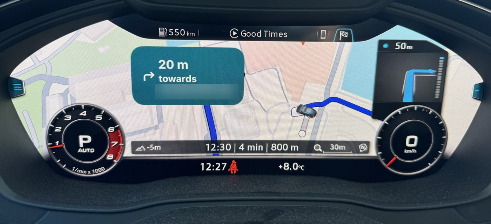

# CarPlay in the Audi Virtual Cockpit: MHI2 AUG22 (K3346)

**The CarPlay map, turn-by-turn directions, album art and your CarPlay calls in the
Virtual Cockpit**, for Audi MHI2 head units on **`MHI2_ER_AUG22_K3346`** (MU1438).

A port of **[chefranov's CarPlay patches](https://github.com/chefranov/mhi2-au37x-carplay)**
(v1.1.13) to the AUG22 K3346 firmware, made **with chefranov's permission**. His
installer, jars and native parts do the heavy lifting; this build adapts them to K3346,
adds the cockpit phone tab and keeps only what was tested on that firmware.

**[⬇ Download the latest release](https://github.com/top11r/mhi2-aug22-carplay/releases/latest)**
· [Changelog](CHANGELOG.md)

> **Private build.** Use at your own risk; everything is reversible with the uninstaller.


## Features

| | |
|---|---|
|  | **Route guidance**: CarPlay turn-by-turn maneuvers in the cockpit's maneuver tile: the arrow, the distance, the street and lane guidance, drawn live. The arrow fills blue as the turn gets closer. Works with Apple Maps and Google Maps. |
|  | **Album art**: CarPlay artwork on the cockpit's now-playing widget. |

- **CarPlay map in the Virtual Cockpit** (above): the phone's navigation map (Apple
  Maps, Google Maps, Waze) in place of the stock one, about 30 fps, decoded by the head
  unit's video hardware. Zoom with the left steering-wheel roller; a long press swaps
  back to the stock map.
- **Phone tab in the Virtual Cockpit**: CarPlay calls on the cockpit's phone tab.
  Answer, decline, hang up, hold and resume, and mute from the cockpit, or answer and
  hang up with the steering-wheel **Tel** key. Missed calls, signal, and the iPhone's
  recents and favourites to call from.
- **Touchpad → D-pad**: the MMI touchpad navigates CarPlay menus.
- **CarPlay settings in the car**: every feature can be switched in the MMI's own menu,
  no reinstall needed.

<sub>Photos: chefranov's project.</sub>

## Quick start

1. Download `mhi2-aug22-carplay-<version>-sd.zip` from the
   [latest release](https://github.com/top11r/mhi2-aug22-carplay/releases/latest) and
   unpack its `mod` folder to the root of a FAT32 SD card.
2. In M.I.B.: **Advanced Settings → Run Custom Script** (**Run individual script** on
   M.I.B. V3.6 and later).
3. **Restart the MMI** and plug in the iPhone by cable.

Details, a network-cable install and options are under [Install](#install).

## Compatibility

Tested on `MHI2_ER_AUG22_K3346`, MU1438, with the Virtual Cockpit and the HARMAN iAP2
stack. **No coding or adaptations** are needed on the unit. Remove any other CarPlay or
HMI mod first; the installer stops if it finds one.

| | |
|---|---|
| **`MHI2_US_AUG22_K3347`** (NAR) | Same HMI release, byte-identical CarPlay natives (only 12 unrelated HMI classes differ). Confirmed on a car: album art, route guidance, the CarPlay map. |
| **Wireless adapters** | The CarPlay map works through an adapter that passes the cluster stream. **Ottocast Mini Cube 3**: confirmed. **Carlinkit Mini Ultra 3**: CarPlay runs but the cluster stream was not opened; an adapter firmware update might be needed. Roller zoom works by cable only. |
| **Navigation apps** | Route guidance: Apple Maps and Google Maps. Waze sends no turn-by-turn data over CarPlay; its map still shows in the cockpit. |
| **Other firmware** | The installer accepts `MHI2_*_AUG22_K3346` and `MHI2_*_AUG22_K3347` only and stops, changing nothing, on anything else. |

## Install

The card has a single folder, `mod`: `mod/custom.sh`, `mod/command.sh`,
`mod/carplay/install.sh`, `mod/carplay/uninstall.sh`, `mod/carplay/bin/` and
`mod/carplay/VERSION`.

**From an SD card (M.I.B.):**

1. Copy the `mod` folder to the root of a FAT32 card. Don't drag it over an existing
   `mod` folder on a Mac: Finder replaces the folder, it doesn't merge them.
2. Insert the card, then in M.I.B. run `Advanced Settings → Run Custom Script`
   (`Advanced Settings → Run individual script` on M.I.B. V3.6 and later).
3. Read the log on screen (it is also in `/tmp/carplay_install.log`), then **restart
   the MMI**. If the installer stopped, the unit is unchanged; the log says why and a
   copy is on the card as `mod/carplay/last_run.log`.

**Over a network cable:** from the folder that contains `mod`:

```sh
ssh root@172.16.250.248 'mount -uw /mnt/app; mkdir -p /mnt/app/root/carplay'
scp -O -r mod/carplay/* root@172.16.250.248:/mnt/app/root/carplay/
ssh root@172.16.250.248 'sh /mnt/app/root/carplay/install.sh'
```

Running the installer again upgrades in place and keeps the settings chosen in the car.

| Option | Cable | SD card (empty file in `mod/carplay/`) |
|---|---|---|
| leave out route guidance and the cluster map | `RGI=0 sh install.sh` | `NO_RGI` |
| leave out only the cluster map | `ALTSCREEN=0 sh install.sh` | `NO_ALTSCREEN` |
| leave out the touchpad as arrow keys | `DPAD=0 sh install.sh` | `NO_DPAD` |
| leave out the album art in the virtual cockpit | `COVERART=0 sh install.sh` | `NO_COVERART` |
| let unknown jars through | `IGNORE_CONFLICTS=1 sh install.sh` | `IGNORE_CONFLICTS` |

## Settings

**MENU → Audi smartphone interface → Switch to CarPlay settings**, with no phone
connected. Settings are changed in the car, not by the installer.

| Row | Default | Takes effect |
|---|---|---|
| CarPlay in virtual cockpit (off: no maneuvers and no CarPlay map in the cockpit) | on | after an MMI restart |
| Route guidance › Directions in virtual cockpit (off: the CarPlay map without maneuvers) | on | next phone plug |
| Route guidance › Force sport view layout (only if the map ignores the sport view) | off (follow the cluster) | within 5 s |
| Route guidance › Show arrival time first | off | within 5 s |
| Route guidance › Fill arrow as the turn gets closer | on | after an MMI restart |
| Route guidance › End MMI route when CarPlay navigates | on | next phone plug |
| Virtual cockpit map › CarPlay map in virtual cockpit | on | within 1 s (also the roller long press) |
| Virtual cockpit map › Offer map to wireless adapters | off | next phone plug |
| Phone tab in virtual cockpit (off: the stock phone tab during CarPlay) | on | next phone plug |
| Restart CarPlay | – | restarts the CarPlay services; plug the iPhone in again |

The first install sets these defaults; later installs keep what was chosen in the car.

## Using it

- **Cluster map**: comes up with the phone, after a short "CarPlay Navigation" intro. A
  **long press of the left steering-wheel roller** swaps between the CarPlay map and the
  stock one; the choice is kept.
- **Route guidance**: start a route on the phone. While the car is off the road network
  (parked, before joining the route) the maneuver tile stays closed; it opens with the
  first turn. A **short press of the left roller** swaps the line under the maneuver
  between the next street and the arrival time. A route the car's own navigation holds
  is ended when CarPlay navigates, so it doesn't take the cockpit back.
- **Phone tab**: an incoming CarPlay call pops up in the cockpit; answer or decline
  there or with the steering-wheel **Tel** key (pressed again, it hangs up). During a
  call the tab offers hold, mute and end call. The call lists show the iPhone's
  recents and favourites; select one to call it. The Tel key also clears the
  missed-call icon.
- **Sport layout** is detected by itself; **Force sport view layout** forces it if that
  ever fails.
- **CarPlay doesn't come back after a reconnect**: **Restart CarPlay** in the settings,
  then plug the iPhone in again. If it still doesn't start, restart the MMI.

Known behaviour of the stock USB stack: after unplugging, the head unit sometimes misses
the removal, and CarPlay stays on screen until its 30-second watchdog ends the session;
plugging in again only works once the old USB session is gone.

## Uninstall

```sh
ssh root@172.16.250.248 'sh /mnt/app/root/carplay/uninstall.sh'
```

or from the card: an empty `UNINSTALL` file in `mod/carplay/`, the same M.I.B. menu item,
then restart the MMI.

## Under the hood: what differs from chefranov's release

- **`librgd_hook.so`**: chefranov's, with his fix for the `mm-ipod` lockup after
  reconnects ([#79](https://github.com/chefranov/mhi2-au37x-carplay/issues/79)): the
  hook sends from a thread of its own, which also keeps the cockpit's call actions
  instant.
- **HMI jars** (`dpad_hook.jar`, `coverart_hook.jar`, `rgd_hook.jar`): rebuilt against the
  K3346 HMI. `rgd_hook.jar` also fixes the update of the cockpit's own maneuver tile,
  which failed in every K3346 build.
- **Phone tab**: rebuilt for this HMI. Call state comes from the head unit's own
  CarPlay service; call actions, recents, favourites and dialing go to the iPhone
  through `libcarplay_tel.so` (ours, [`src/carplay_tel`](src/carplay_tel)), preloaded
  into `mm-ipod` next to `librgd_hook.so`. chefranov's native telephony module stays
  off (`rgd_no_tel` is set): its list traffic stalled the iPhone link on K3346.
- **`libcarplay_hook.so`**: patched for the K3346 CarPlay library: the cluster stream's
  socket family, the session key's offset, `TCP_NODELAY` on the link to the cluster-map
  renderer (smooth zoom), and roller zoom steps 262 ms apart (no skipped steps).
- **`altscreen_render`** (the cluster-map renderer): decodes a frame as soon as one is
  waiting instead of only when five are buffered (it can catch up after bursts), and
  passes the hardware decoder timestamp 0, so it no longer drops frames it considers late.
- **No compiled shaders**: the K3346 GPU driver (17.37) compiles the renderers' built-in
  GLSL with its own run-time compiler, so no shader files are shipped or installed, and
  ones an earlier install left are removed.
- **The car's own route is cancelled** when CarPlay route guidance starts
  (`rgd_cancel_native`, the *End MMI route when CarPlay navigates* setting).
- **CarPlay settings menu** ([`src/mmi_settings`](src/mmi_settings)): ours.
- **No parking popup**: not ported to this HMI.

## Credits

- **[chefranov](https://github.com/chefranov)**: the project this build is based on, its
  installer, hooks, jars, renderers and route guidance. Support his work:
  [Ko-fi](https://ko-fi.com/chefranov) or [monobank](https://send.monobank.ua/jar/HdecLxjBN).
- His credits: [luka-dev/mib2q-carplay-rgi](https://github.com/luka-dev/mib2q-carplay-rgi)
  (the HMI patch pattern, cover art, route-guidance BAP work, the maneuver renderer and
  lane guidance), [Mich795](https://github.com/Mich795) (cover-art fixes) and
  [aberbic](https://github.com/aberbic/Audi-MHI2-Virtual-Cockpit-Altscreen-CarPlay-AndroidAuto)
  (the hardware-decoder layer setup for the cluster map).
- **[luka-dev/mib2q-carplay-rgi](https://github.com/luka-dev/mib2q-carplay-rgi)**: the
  iAP2 telephony message layouts and captured frames behind `libcarplay_tel.so`
  (`IAP2_COMMUNICATIONS.md`, `tel_hook.c`) and the cockpit phone-tab notes.

## Licence

Everything in this repository is under chefranov's [LICENSE](LICENSE), except top11r's
own code, which is under GPL-3.0-or-later:

- [`src/mmi_settings`](src/mmi_settings) (the CarPlay settings menu,
  `bin/mmi_settings.jar`), with an additional permission to combine it with the head
  unit's own HMI classes (see [`src/mmi_settings/LICENSE`](src/mmi_settings/LICENSE)).
  It is built with `src/mmi_settings/build.sh` and a stock `lsd.jar` converted from your
  own unit.
- [`src/carplay_tel`](src/carplay_tel) (`bin/libcarplay_tel.so`, the phone tab's call
  actions and lists; see [`src/carplay_tel/LICENSE`](src/carplay_tel/LICENSE)). It is
  built with `src/carplay_tel/build.sh` in a QNX 6.5 toolchain container.
